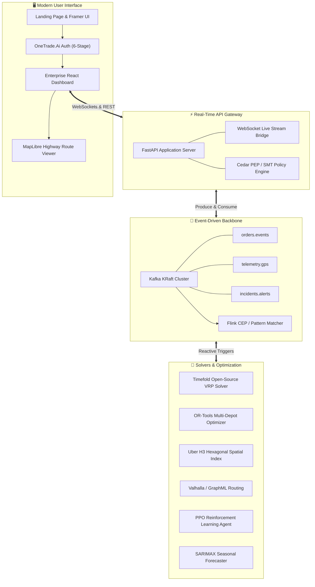

# 🌐 ORION · AUTONOMOUS X

[](https://fastapi.tiangolo.com)
[](https://react.dev)
[](https://tailwindcss.com)
[](https://kafka.apache.org)
[](https://timefold.ai)
[](https://python.org)
[](LICENSE)

> **Next-generation autonomous logistics, real-time fleet telemetry, and resilient dispatch intelligence.**
> From highway corridor tracking across the Delhi–Jaipur freight expressway to sub-second vehicle rerouting during unexpected urban gridlock, Orion Autonomous X orchestrates demand, physical supply, and autonomous fleets from one unified control plane.

---

## 💡 Why We Built Orion

Logistics operations are running on decades-old software. When a highway closes, a truck breaks down, or an urgent medical delivery is placed, traditional dispatchers spend hours manually recalculating schedules across fragmented spreadsheets. 

**Orion Autonomous X** reimagines freight and fleet management from first principles:
- **It is real-time first**: Instead of polling databases every 10 minutes, continuous Kafka event streams and WebSocket pipelines stream live vehicle GPS telemetry, inventory deltas, and sensor alerts directly into operators' hands.
- **It thinks ahead**: Combining **Timefold open-source optimization** with OR-Tools multi-depot VRP solvers, SARIMAX seasonal demand forecasting, and PPO reinforcement learning, Orion proactively balances capacity and reroutes vehicles around disruptions before traffic jams even form.
- **It looks and feels human**: Built with a modern React + Tailwind CSS v4 design language, operators can jump from a bird's-eye regional capacity overview down to individual vehicle telemetry gauges and driver communications in a single click.

---

## 🏛️ System Architecture



---

## ✨ Key Features & User Experience

### 1. 🌐 Public Landing & OneTrade.Ai Onboarding
- **Framer Public Experience**: High-converting freight forwarder showcase with air, sea, and road freight capabilities.
- **OneTrade.Ai Enterprise Authentication**: A 6-screen onboarding modal with real-world illustration banners:
  - Account Sign-in with remember me & passwordless options
  - Password Reset & recovery email dispatch
  - Multi-factor OTP code verification
  - Organization Registration & Business entity setup
  - Contact Details & Role profiling
  - Instant dispatch to the operations control plane

### 2. 📊 Enterprise Overview Dashboard (`LogisticsOverview`)
- **Recent Orders Analytics**: Interactive monthly timeframe selector, active KPI cards (720 Active, 120 Pending, 450 Accepted), and smooth SVG area demand charts showing `↑ 40%` month-over-month growth.
- **Loading Trucks Donut Breakdown**: Instant visualization across 120 fleet units categorized into *Active*, *Loading Delayed*, *Ready to Load*, *Unloading Delayed*, *Ready to Unload*, and *Canceled*.
- **Live Shipping Registry**: Data grid highlighting recent dispatches, delivery statuses, cargo weights, routes, and arrival dates.
- **Available Cargo & Utilization**: Progress monitors showing load percentages and one-click proof-of-delivery downloads.
- **Order Requests Feed**: Real-time incoming demand requests with pickup/destination tags, customer pills, and route mini-map previews.

### 3. 🚚 Live Delivery Tracking (`DeliveryTrackingView`)
- **Interactive Route Map**: Centered on major freight corridors (Delhi ➔ Gurugram ➔ Rewari ➔ Kotputli ➔ Shahpura ➔ Jaipur) rendered via MapLibre GL.
- **Floating Telemetry Overlay**: Live highway location indicator (`NH04 - Jaipur Highway`), remaining distance (`240 KM Left`), last checkpoint timestamp, and real-time speedometer gauges (`120 Kmps`).
- **Interactive Tour Guide**: Step-by-step contextual tooltip guiding operators through real-time telemetry filters.
- **Driver Card & Communication**: Quick driver profiling (`#Driv012345`) with direct contact actions.
- **Vehicle Details & Specs Card**: Technical breakdown featuring the real-world **Eicher Pro 2059** truck, including license registration, cargo volume (`35,393 Ltr`), max load capacity (`6.5 Ton`), and load dimensions (`11.7m × 4.8m`).

### 4. ⚡ Real-Time Streaming & Zero-Trust Governance
- **Kafka KRaft Infrastructure**: Decoupled event topics eliminating Zookeeper dependencies for high-throughput messaging.
- **Complex Event Processing (CEP)**: Flink-style patterns detecting delivery delays, route deviations, and cargo temperature anomalies.
- **Cedar SMT Policy Enforcement**: Formal verification ensuring every vehicle dispatch, route adjustment, and warehouse access request complies with strict security policies.

---

## 🛠️ The Tech Stack

| Layer | Technologies |
| :--- | :--- |
| **Frontend** | React 18, TypeScript, Tailwind CSS v4, Vite, MapLibre GL, Recharts, Lucide Vectors |
| **Backend API** | FastAPI, Uvicorn, Python 3.12, WebSockets, Pydantic v2 |
| **Simulation Core** | SimPy (Discrete-event simulation engine), NetworkX, OSMnx |
| **Solvers & AI** | Timefold Open-Source Solver, Google OR-Tools, Gymnasium, Stable-Baselines3 (PPO), SARIMAX |
| **Spatial Indexing** | Uber H3 Hexagonal Spatial Index, Valhalla routing engine, GeoJSON |
| **Event Streaming** | Apache Kafka (KRaft mode), Apache Flink CEP rule patterns |
| **Security & Auth** | AWS Cedar Policy Engine, SMT solver verification, JWT token authentication |

---

## 🚀 Getting Started

### Prerequisites
- **Python**: 3.12 or higher
- **Node.js**: 18.0 or higher (`npm` / `pnpm`)
- **Docker** *(optional, for Kafka KRaft stack)*: Docker Desktop / Engine

### 1. Clone the Repository
```bash
git clone https://github.com/SATTWIK-DEBNATH/EDGERRUNNERS---ORION.git
cd EDGERRUNNERS---ORION/EDGERUNNERS/AUTONOMOUS\ X
```

### 2. Set Up the Backend
```bash
cd backend
python -m venv .venv

# On Windows (PowerShell):
.\.venv\Scripts\Activate.ps1
# On macOS / Linux:
source .venv/bin/activate

pip install -r requirements.txt
```

Run tests to ensure everything is configured:
```bash
python -m unittest discover -s tests -p "test_*.py"
```

Start the FastAPI application server:
```bash
python -m uvicorn app.api.main:app --host 127.0.0.1 --port 8000 --reload
```
*API docs will be available at [http://127.0.0.1:8000/docs](http://127.0.0.1:8000/docs).*

### 3. Set Up the Frontend
In a new terminal window:
```bash
cd frontend
npm install
npm run dev
```
*The web app will launch at [http://127.0.0.1:5173](http://127.0.0.1:5173).*

### 4. Optional: Spin Up Kafka & Flink (Docker Compose)
To run the full event streaming backbone locally:
```bash
docker compose up -d
bash scripts/create_kafka_topics.sh
```

---

## 🧪 Testing & Validation

Every critical component of Orion Autonomous X is covered by automated unit and integration tests:

- **Frontend Tests (`Vitest` + Testing Library)**:
  ```bash
  cd frontend
  npx vitest run
  ```
  *Tests component rendering, authentication state transitions, route map fallback, and dashboard views.*

- **Backend Tests (`unittest`)**:
  ```bash
  cd backend
  python -m unittest discover -s tests -p "test_*.py"
  ```
  *Validates Cedar policy enforcement, H3 spatial calculations, Timefold solver integration, Kafka emitter pipeline, and SimPy simulation clock.*

- **Production Build Check**:
  ```bash
  cd frontend
  npm run build
  ```
  *Compiles TypeScript and bundles CSS with zero errors.*

---

## 📂 Project Structure

```
EDGERUNNERS/AUTONOMOUS X/
├── backend/
│   ├── app/
│   │   ├── agents/          # Autonomous proposal & coordination agents
│   │   ├── api/             # FastAPI REST endpoints & WebSocket bridge
│   │   ├── auth/            # Cedar policy engine & SMT verification
│   │   ├── events/kafka/    # Kafka producers, consumers, and topic schemas
│   │   ├── graph/           # Valhalla routing & OSMnx network graphs
│   │   ├── optimization/    # Timefold open-source & OR-Tools VRP solvers
│   │   ├── spatial/         # Uber H3 hexagonal spatial indexing
│   │   ├── telemetry/       # Live vehicle GPS emitter & sensor simulation
│   │   └── simulation/      # SimPy discrete-event simulation kernel
│   ├── tests/               # Backend unit and integration test suite
│   └── requirements.txt
│
├── frontend/
│   ├── public/
│   │   ├── assets/          # Vehicle photos, avatars, and route minimaps
│   │   ├── auth/            # OneTrade.Ai onboarding hero illustrations
│   │   └── landing.html     # Autonomous X logistics Framer landing page
│   ├── src/
│   │   ├── components/
│   │   │   ├── dashboard/   # Sidebar, TopNavbar, LogisticsOverview, DeliveryTrackingView
│   │   │   ├── AuthModal.tsx
│   │   │   ├── LandingPage.tsx
│   │   │   ├── OperationsMap.tsx
│   │   │   └── StreamMonitor.tsx
│   │   ├── App.tsx          # Main application router and state machine
│   │   └── styles.css       # Tailwind CSS v4 directives & typography
│   ├── package.json
│   └── vite.config.ts
│
├── scripts/
│   └── create_kafka_topics.sh
└── docker-compose.yml       # Kafka KRaft & local infrastructure
```

---

## 🤝 Contributing

We welcome contributions to Orion Autonomous X! Whether you're adding new routing heuristics, expanding telemetry sensor formats, or improving the frontend interface:

1. Fork the Project
2. Create your Feature Branch (`git checkout -b feature/AmazingFeature`)
3. Commit your Changes (`git commit -m 'Add some AmazingFeature'`)
4. Push to the Branch (`git push origin feature/AmazingFeature`)
5. Open a Pull Request

---

## 📜 License

Distributed under the MIT License. See `LICENSE` for more information.

---

<div align="center">
  <sub>Crafted with passion for the future of autonomous supply chains · Powered by <b>Orion Autonomous X</b></sub>
</div>
