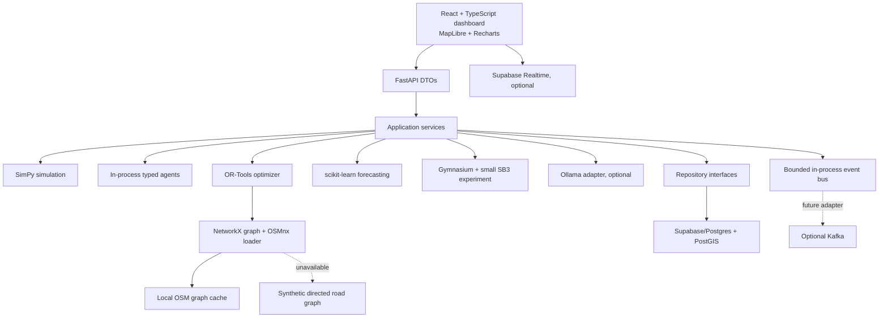
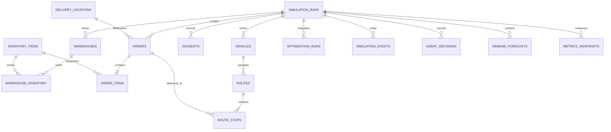

# AUTONOMOUS X Architecture

## Intent

Build a locally runnable logistics simulation that makes real, reproducible allocation and routing decisions. The initial demo targets Bengaluru and starts with three warehouses, ten vehicles, and twenty orders. Simulated traffic and synthetic data must be labeled as such; missing map data must produce an explicit synthetic-road fallback.

## Goals and constraints

- Use the requested stack: Python/FastAPI, Supabase PostgreSQL/PostGIS, SimPy, OSMnx/NetworkX, OR-Tools, scikit-learn, Gymnasium/Stable-Baselines3, Ollama, and React/TypeScript/MapLibre/Recharts.
- Keep a modular monolith that can run locally without paid services or a large container stack.
- Keep domain, persistence, graph, solver, and API models separate.
- Keep solver and simulation operation functional when Supabase, Ollama, live map downloads, or RL are disabled by configuration.
- Validate all operational decisions deterministically before state changes.
- Treat forecast, RL, and LLM output as recommendations; never as authority over inventory, route commitment, or authorization.

## Approaches considered

1. **Modular monolith (selected):** one Python application with explicit domain modules and adapters, plus one React frontend. It matches the prototype scale, simplifies deterministic simulation and local setup, and preserves boundaries for later extraction. Tradeoff: modules share a process and need deliberate interfaces.
2. **Service-per-capability:** separate simulation, routing, agents, forecasting, and UI services. It gives deployment isolation but adds operational overhead, distributed consistency problems, and resource use before the prototype proves its behavior.
3. **Dashboard-first mock:** build the map and charts against sample responses. It is quick to display, but violates the requirement that visible outcomes come from a functioning simulator and optimizer.

## Runtime architecture

The API and simulator use typed domain objects and application services. Repository interfaces isolate Supabase records. The graph adapter owns road topology and travel costs. The OR-Tools adapter receives a dedicated solver problem and maps a validated solution back to domain assignments. At simulation creation, the coordinator first commits stock-, warehouse-, vehicle-, and event-checked assignments; the optional OR-Tools initial-dispatch strategy then proposes a vehicle allocation and stop order for those assignments. The validated result is applied before SimPy starts and directly defines its per-vehicle task queues. A solver or validation failure keeps the coordinator allocation and reports `baseline_fallback`. This is a one-time planning step, not work inside delivery processes. The initial event bus is in-process and bounded; it is not a second source of truth.

## Data boundaries and units

- **Domain:** warehouse, stock, vehicle, order, route, stop, incident, simulation run, agent decision, forecast. Coordinates are WGS84 latitude/longitude; timestamps are UTC; distance is metres; duration is seconds; payload is kilograms.
- **Persistence:** normalized SQL records and PostGIS points/lines; no NetworkX graph serialization in the operational database.
- **Road graph:** directed NetworkX MultiDiGraph, OSMnx sourced and locally cached when available. Edge travel-time weights account for speed, synthetic congestion and closures. Synthetic graph operation is labeled `synthetic_fallback`.
- **Optimization:** immutable solver input/output types; integerized travel seconds and demand units, explicit unreachable arcs, vehicle-specific depots, capacity and time limits.
- **API:** Pydantic request/response DTOs only; no internal ORM, graph, solver or SimPy objects cross the API boundary.

## Initial domain model

All operational tables use UUID primary keys, `simulation_run_id`, UTC `created_at`/`updated_at` where appropriate, foreign keys, status checks, and indexes for run/status/time and geographic queries. Inventory quantity is constrained nonnegative. Vehicle capacity is positive. Active order assignment is protected by a partial unique constraint or transaction-safe repository operation. Supabase service credentials stay server-side. RLS is enabled for user-owned runs; local synthetic mode uses the same domain contracts without requiring credentials.

## Event contracts

Each event has `event_id`, `event_type`, `occurred_at` (UTC), `simulation_run_id`, `schema_version`, and typed `payload`.

| Event | Payload essentials | Consumers |
|---|---|---|
| `OrderCreated` | order id, destination, items, priority, time window | coordinator, warehouse, demand |
| `AssignmentProposed` | order, warehouse, vehicle, reason, expected costs | coordinator |
| `RouteCommitted` | route id, vehicle, ordered stops, graph source, solver status | simulation, persistence, UI |
| `VehicleMoved` | vehicle, coordinates, route progress, simulation time | metrics, UI |
| `DeliveryCompleted` | order, vehicle, delivered time | inventory, metrics, UI |
| `IncidentRaised` | kind, affected entity/edge, severity, duration | recovery, routing, UI |
| `RecoveryCommitted` | affected orders, accepted plan, rejected alternatives, reason | simulation, audit, UI |
| `ForecastProduced` | region/period, predicted quantity, model and metrics | demand agent, UI |

Handlers must be idempotent by event ID. Queue capacity and overflow behavior are explicit. Events do not bypass transaction and feasibility checks.

## Milestone acceptance map

| Milestone | Primary modules | Acceptance evidence |
|---|---|---|
| M0 Architecture | `docs/architecture.md`, `docs/milestones.md`, `docs/database.md` | Runtime diagram, ER diagram, type boundaries, event contracts, constraints, setup/resource decisions, requirement trace, sequenced acceptance criteria |
| M1 Simulation | `backend/app/domain`, `simulation`, `database/migrations`, `scripts`, `backend/tests` | Seeded order advances through assignment, movement and delivery; fixed seed reproduces state |
| M2 Graph + optimization | `backend/app/graph`, `optimization` | directed shortest path and closure behavior; OR-Tools solution respects depot/capacity/time constraints; explicit fallback and infeasible statuses |
| M3 Agents | `backend/app/agents`, `events` | typed agent proposals flow through coordinator; invalid proposal is rejected and logged |
| M4 Recovery | `backend/app/recovery`, incident handlers | congestion, vehicle failure, warehouse outage, urgent-order insertion and stability rules recover feasible work |
| M5 Intelligence | `backend/app/intelligence`, `analytics` | time-split forecasting metrics; reproducible CPU PPO evaluation against rule baseline; recommendations are feasibility checked |
| M6 User interface | `frontend`, API routes, realtime adapter | user controls simulation and sees actual state, route, incidents and metrics without refresh |
| M7 Demo | setup docs, demo script, integration checks | clean local setup and reproducible full scenario; optional integrations can be disabled; claims match recorded results |

The prompt's requirements map to these modules: database/schema/security to `database`; simulation lifecycle and scenarios to `simulation`; road sourcing, cache, graph weights, and paths to `graph`; VRP and baseline to `optimization`; coordinator roles to `agents`; disruption and re-planning to `recovery`; forecast/RL/LLM to `intelligence`; REST DTOs to `api`; map/charts/controls to `frontend`; metrics/comparison/demo to `analytics` and `scripts`.

## Resource and local operation strategy

Start with one backend process and small scenario defaults (3/10/20). Keep OSM extraction to a configurable Bengaluru area and cache it locally; use a small synthetic graph on download failure. Make Supabase, LLM, RL and live OSM independently optional. Do not load Ollama at app startup. RL training is CPU-only, single-worker, and not concurrent with LLM inference by default. Memory usage is qualitative and must be measured before publishing estimates.

## Explicit prototype limits

Traffic and weather are simulated; no claim of live traffic. RL is a small warehouse-selection experiment, not MARL. Synthetic map output is approximate and clearly labeled. Local mode without Supabase is useful for development, while persistent shared operational use requires configured Supabase migrations and policies. No production-grade dispatch guarantee is implied by a small reproducible demo.

### Initial route execution strategy (R1)

- `ROUTE_OPTIMIZATION_STRATEGY=baseline` preserves the existing coordinator-first initial dispatch and is the default. The CLI also accepts `--route-strategy baseline`.
- `ROUTE_OPTIMIZATION_STRATEGY=ortools` (or CLI `--route-strategy ortools`) runs OR-Tools once after coordinator assignments are committed and before SimPy starts. The solver sees each order as a distinct stop, respects vehicle capacity and availability, and prices each stop using its already-reserved warehouse pickup. Its vehicle assignment and stop order are applied to the simulation engine's queues.
- Exceptions, infeasible results, incomplete assignments, duplicate or malformed routes, and capacity violations are rejected before changing assignments. The coordinator plan remains runnable and the report identifies `baseline_fallback` with a reason.
- Warehouse choice and stock reservation remain coordinator decisions. Optimization only redistributes the coordinator-approved initial orders across vehicles; it does not jointly optimize inventory sourcing, and delivery routing still recomputes paths against the live graph during execution. Dynamic incidents and new orders continue through the existing recovery/coordinator flow.
